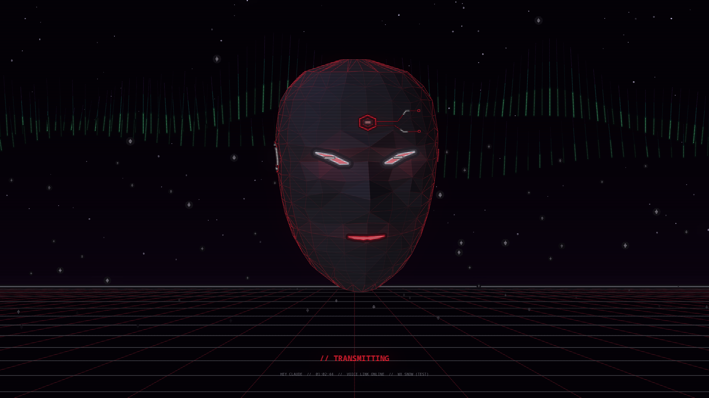
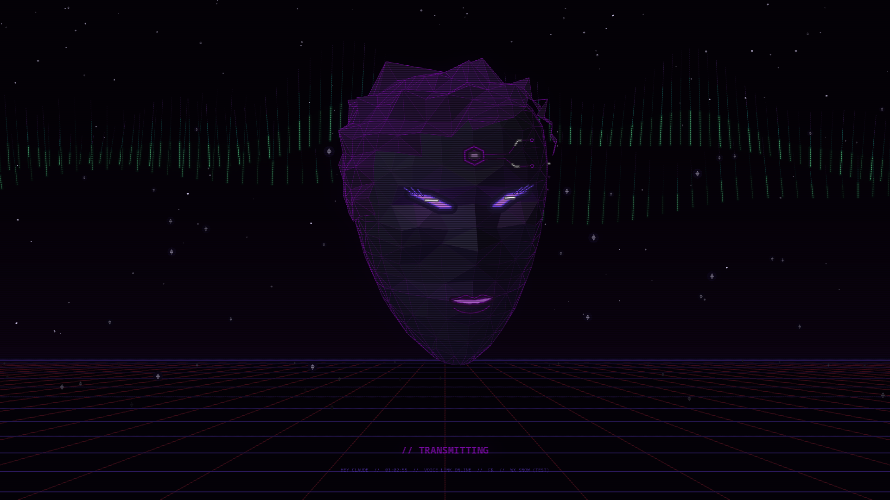

# jarvis-desktop

**A fun experiment, not a real tool.** This is me goofing around with Claude Code to see how far I could
push a "movie AI assistant" vibe on my Linux desktop. It's held together with tape, it's tuned to my own
machine, and it will probably not work on yours without some fiddling. Mostly AI-assisted code, not
maintained, but feel free to steal ideas from it.



<details>
<summary>The other face (it switches when a female voice is speaking)</summary>


</details>

## What it does

- **"Hey Jarvis" wake word.** Always listening (locally, with openWakeWord). Say it, hear a chime, and a fresh
  Claude Code session starts talking to you by voice through [VoiceMode](https://github.com/mbailey/voicemode).
  It calls itself Jarvis, answers in English or French, and can hand real coding work to a bigger model.
- **A live face as your wallpaper.** A low-poly neon android head drawn behind your windows. It reacts to
  what the assistant is doing (standby, thinking, listening, speaking), slides away from your windows, and
  turns to look at whichever one you're focused on. The voice picks which face shows up.
- **A living sky behind it.** Real sun and moon (with the actual moon phase), stars, northern lights from
  live space-weather data, meteor showers, ISS flyovers, and live rain, snow and lightning.
- **"Vital signs".** The grid speeds up with CPU load, the horizon glows hotter with CPU temperature, and
  everything flickers when the battery is low.
- **It can see your screen.** Ask "what's this error?" and it takes a screenshot and looks.
- **"ENHANCE!"** Yes, like in the movies. It zooms into whatever is under your mouse with a dramatic
  animation, then describes it with a straight face.
- **Kill switch and on/off hotkeys**, because an always-listening AI should have an off button.

## What you'd need

This only really works on something close to my setup:

- Linux with **X11** (I use Cinnamon); no Wayland
- [Claude Code](https://claude.com/claude-code) and [uv](https://docs.astral.sh/uv/)
- VoiceMode with local speech services (Kokoro for the voice, Whisper for listening)
- `xdotool`, `xprop`, `ffmpeg`, `maim`, `notify-send`, `pactl`/`parec`
- An OpenGL-capable GPU for the fast renderer (there's a slower Tk fallback)

## Files

| File | What it is |
|---|---|
| `hey_claude.py` | Wake-word listener; starts the voice session (the whole Jarvis personality is the prompt in here) |
| `face_wallpaper.py` | The face, weather and HUD (Tk version) |
| `face_wallpaper_gl.py`, `head_gl.py` | GPU renderer for the same scene, much lighter on the CPU |
| `sky.py` | Sun, moon, stars, aurora, meteors, ISS, vital signs |
| `f5_action.sh` | One key that ends listening during a voice session, or play/pause otherwise |
| `bin/jarvis-*` | Helpers: `look` (screenshot), `enhance`, `kill`, `toggle`, `term`, `checkpoint` (memory between sessions) |
| `autostart/` | Example autostart entries |

## If you want to try anyway

```sh
git clone https://github.com/ThermoVR/jarvis-desktop ~/.local/share/hey-claude
cd ~/.local/share/hey-claude
ln -s "$PWD"/bin/jarvis-* ~/.local/bin/
mkdir -p ~/.config/hey-claude && cp weather.conf.example ~/.config/hey-claude/weather.conf  # add your coordinates
./face_wallpaper_gl.py &   # the face
./hey_claude.py            # the wake word
```

Every script has its settings and test switches documented at the top (for example `FACE_DEMO=1` cycles
through the face's states and `FACE_WEATHER=storm` forces a thunderstorm). Hotkeys are up to you; I bound
the kill switch to Super+Escape and the on/off toggle to Super+J.

**Heads-up:** the voice session runs Claude Code with permission to use Bash and edit files without asking,
since nobody is at the keyboard to approve things. That's fine for a toy on my own machine, but read
`hey_claude.py` and trim `HEY_CLAUDE_TOOLS` before you run it.

## License

MIT
